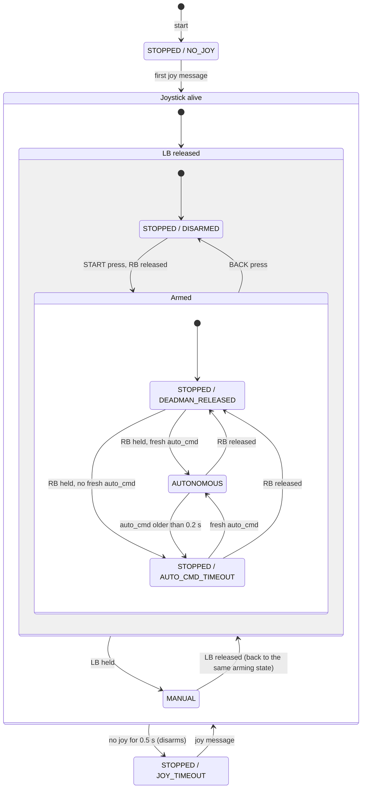

# rbsf-racing
RobeSafe Racing Stack for RoboRacer Autonomous Racing

## Installation

Requires git and Docker (with BuildKit, Docker 23+). Add the NVIDIA Container Toolkit for GPU
access. Nothing else is installed on the host.

Third-party ROS packages (`f1tenth_gym_ros`, and `vesc` for the real car's motor controller) are
git submodules under `src/`. Clone the `dev` branch (day-to-day work; `main` holds stable
releases) with `--recurse-submodules` to also download its submodules:

```bash
git clone --branch dev --recurse-submodules https://github.com/RobeSafe-UAH/rbsf-racing.git
cd rbsf-racing
```

After switching branches or pulling changes, or if you cloned without `--recurse-submodules`,
update the submodules before building:

```bash
git submodule sync --recursive
git submodule update --init --recursive
```

Then build the image and start the container:

```bash
make build        # dev image on x86_64, robot image on aarch64 (override with FLAVOR=dev|robot)
make run          # start the container; the repo is mounted at /ros2_ws and built on start
make attach       # open another shell in the running container
make help         # list all targets and variables
```

Images are based on ROS 2 Jazzy / Ubuntu 24.04 and contain nothing specific to the host,
so rebuilding (on a workstation or on the car) reuses cached layers. When a `package.xml`
or `pyproject.toml` changes, the container warns you to run `make build` again.

## Naming

Every car lives in its own namespace, in simulation and on the real cars:

| Namespace | What |
|---|---|
| `/r0`, `/r1` | Our cars (real or simulated ego). TF frames: `r0/base_link`, `r0/laser`, ... |
| `/opponents/or0`, `/opponents/or1`, ... | Simulated opponents, numbered from 0 |

Inside each namespace: `scan` (`sensor_msgs/LaserScan`), `odom` (`nav_msgs/Odometry`, frame
`<ns>/odom`) and `drive` (`ackermann_msgs/AckermannDriveStamped`). `/map` and `/tf` are global.
The TF tree is `map -> <ns>/odom -> <ns>/base_link -> <ns>/laser`, and `map -> <ns>/odom` belongs
to the mapping slot (a SLAM, or the identity when there is none).

## Tracks

`src/base_system/rbsf_worlds` holds the tracks every simulator (and later the car) uses: a ROS map
(yaml + image) plus the reference lines to drive on. Both simulators take `track:=<name>`.

| Track | Length (centerline) | Lines |
|---|---|---|
| `levine` | 61.8 m | centerline |
| `spielberg` | 343.3 m | centerline, raceline (338.1 m, with speed profile) |
| `iros2026` | 209.4 m | centerline |
| `icra2026_classic` | 80.8 m | centerline |
| `icra2026_master` | 152.5 m | centerline (over the 0.7 m bridge; 3D in MVSim only) |

See `src/base_system/rbsf_worlds/tracks/README.md` for the file formats and sources.

A track gets a raceline from its centerline with `scripts/tracks/raceline.py <track | map yaml>`
(in the dev container): a minimum-curvature line inside the walls, checked by sweeping the car's
footprint along it (clearance to the walls and the steering limit), with the curvature-based
speed profile in its `vx` column. It writes `<name>_raceline.csv` next to the yaml only if the
line passes; `line:=auto` then drives it. Details in the tracks README.

## Apps

The stack is split into five interchangeable functional slots (mapping, localization,
perception, planning, controller) that behaviours in `stack_launcher` compose into apps, on any
platform (`real`, `mvsim`, `f1tenth`) and deployment (`local`, `distributed`). See
[`docs/DESIGN_PHILOSOPHY.md`](docs/DESIGN_PHILOSOPHY.md).

Every command to the motors goes through `drive_gate` (`rbsf_safety`), the only publisher on
`/<ns>/drive`. It fails closed: any lost signal stops the car, and a second publisher on `drive`
shuts the whole stack down. Its state is on `/<ns>/drive_gate/state` (JSON `{state, reason,
armed}`): `MANUAL`, `AUTONOMOUS` or `STOPPED` (speed 0, steering 0) with the reason below.



- **Start**: the gate starts `STOPPED / NO_JOY` and stays there until a joystick is seen. A
  joystick never seen keeps the car stopped.
- **Arming** is a flag, set by a START press (rising edge) only while RB is released, so the car
  never moves the instant it is armed. BACK clears it, and so does a joystick timeout: after a
  reconnect the gate is `DISARMED` again. A button already held when the joystick (re)appears
  does not count as a press.
- **MANUAL** pre-empts every other state while the joystick is alive and LB is held: the sticks
  drive. The arming flag is kept underneath (START and BACK still work while in MANUAL), so
  releasing LB lands in `DISARMED` or `Armed`, whichever the flag says.
- **`require_deadman:=false`** (simulators only, refused on `platform:=real`) drops the joystick
  conditions: the gate is `AUTONOMOUS` while `auto_cmd` is fresh, else
  `STOPPED / AUTO_CMD_TIMEOUT`, and LB still pre-empts it.
- Timeouts use the receive time on a monotonic clock, so a stalled simulator or a skewed remote
  clock cannot keep a stale command alive. Buttons and timeouts are in
  `src/base_system/rbsf_safety/config/drive_gate_{sim,real}.yaml`.

### Autonomous exploration

The car follows the inner track boundary, or centres itself between both (`rbsf_wall_following`,
PI on the nearest LiDAR points beside and ahead of the car, with gap and corner handling) while the mapping slot
builds the map. Boundaries may be walls or rows of cones with gaps (tested up to 0.4 m in sim).
The default mapper is DualSLAM (`rbsf_dual_slam`): SLAM Toolbox and Cartographer map side by
side from the same scans.

```bash
ros2 launch stack_launcher autonomous_exploration.launch.py platform:=mvsim track:=spielberg
ros2 launch stack_launcher autonomous_exploration.launch.py platform:=f1tenth track:=spielberg
#   robot:=r0  headless:=true  foxglove:=false  rviz:=false  joy:=false  require_deadman:=true
#   mapping:=dual_slam|slam_toolbox|cartographer|identity ... controller:=wall_following|follow_the_gap

# Save both maps (gamepad Y does the same):
ros2 service call /r0/mapping/save_maps std_srvs/srv/Trigger
```

- Cartographer is the primary mapper: it publishes `/map` and owns `map -> r0/odom`.
  SLAM Toolbox runs without TF on `/r0/mapping/slam_toolbox/map`, in the frame
  `r0/slam_toolbox/map`. `map_overlay` fits that frame to `map` from both trajectories, so the
  two maps overlay in Foxglove.
- A save writes `maps/<YYYYMMDD_HHMMSS>/{slam_toolbox,cartographer}/map.{pgm,yaml}` (nav2
  map_server format, the input of the offline map cleaning and centerline tools), each SLAM's
  own state (`posegraph.*`, `map.pbstream`), each SLAM's own trajectory, ground truth on the
  simulators, and `session.yaml` (platform, track, and each map's frame and pose in `map`). Save
  after driving a little past the start line, so the end of the lap is in both maps.

#### From a mapping session to a track

Step by step for the real car, from bringup to a checked track: [`docs/RACE_DAY.md`](docs/RACE_DAY.md).

Neither SLAM is reliably better (it depends on the track), so the map a track is built from is
chosen per session, after inspecting both. In the dev container, with the workspace sourced:

```bash
python3 scripts/maps/session_track.py inspect maps/<stamp>
#   -> maps/<stamp>/inspection.png (look at it) + inspection.yaml, and a recommended source
python3 scripts/maps/session_track.py centerline maps/<stamp> --source cartographer
#   -> maps/<stamp>/track/<track>_<stamp>.{png,yaml}, _centerline.csv, centerline.png
ros2 launch stack_launcher raceline_tracking.launch.py track:=/ros2_ws/maps/<stamp>/track/<name>.yaml
```

- `inspect` checks every map: the cleaned free space must be one closed corridor (an unclosed
  lap, a doubled wall from a bad loop closure or a large unknown hole fails it), and at least 95%
  of the SLAM's own trajectory must lie inside its own corridor (a drifted or tangled map fails
  it). On the simulators it also scores each map and trajectory against ground truth.
- `centerline` refuses a map that failed inspection unless you pass `--force`. It writes a
  cleaned map (corridor free, rest occupied) and the centerline in the rbsf_worlds format. The
  line is ordered in the driving direction and starts where the car started. Both come from the
  recorded trajectory, and `--ccw/--cw` and `--start X Y` override them. Coordinates are in the
  source map's frame, so the result is a self-contained track for both simulators and the planners.
- The algorithm (`rbsf_worlds/centerline.py`) is shared with `scripts/tracks/drawn_track.py`.
- Optional: `python3 scripts/tracks/raceline.py maps/<stamp>/track/<name>.yaml` adds a checked
  minimum-curvature raceline next to it (see Tracks above).

- The wall follower (`follow_side: left` by default, the inner boundary of a counter-clockwise
  lap; `right` for clockwise, `centre` to centre between both walls) picks a mode on every scan.
  A wall farther than `max_wall_distance` (2.0 m on the simulators, 1.0 m on the car) is lost.
  Gains and distances are in `src/controller/rbsf_wall_following/config/wall_following_{sim,real}.yaml`.

  ```mermaid
  stateDiagram-v2
      direction LR
      [*] --> Centring
      state "Follow side" as Follow
      state "Round wall end" as Round
      state Centring {
          state "Both walls" as Both
          state "One wall" as One
          state "No wall" as None
          Both --> One: a wall lost
          One --> Both: both visible
          One --> None: other wall lost
          None --> One: a wall visible
          None --> Both: both visible
      }
      Centring --> Follow: followed side within side_capture_distance
      Follow --> Centring: side farther than side_capture_distance, or lost for over wall_end_memory, or U-turn does not fit
      Follow --> Round: side lost (within wall_end_memory) and U-turn fits
      Round --> Follow: side within side_capture_distance again
      Round --> Centring: U-turn no longer fits
  ```

  | Mode | Steering |
  |---|---|
  | Follow side | PI to `min(side_distance, half the corridor width)` from the followed side |
  | Round wall end | Full lock towards the followed side (the hairpin around the end of the inner wall), PIs frozen. The U-turn must fit: the full-lock half circle plus `lookahead` m back, clear by `path_half_width`, so a doorway or short alcove is driven past |
  | Both walls | PI to the middle; the corridor width is remembered |
  | One wall | PI to half the width remembered (younger than `width_memory`, 2 s), else `fallback_distance` (0.4 m), from the visible wall |
  | No wall | Holds its heading, PIs frozen |

  Corners override every mode except *Round wall end*: as the free distance in the car's path
  drops from `corner_distance` (1.5 m) to `corner_min_distance` (0.7 m), steering blends into full
  lock, towards the more open side just before the obstacle (with one side followed, towards that
  side while it leaves `side_distance` of room). With `follow_side: centre` only *Centring* exists.
- `controller:=follow_the_gap` (`rbsf_follow_the_gap`, as in the ForzaETH mapping launch) drives
  into the largest gap of the scan instead, so it also goes around static obstacles. Every
  LiDAR point is inflated by the car's half-width (`inflation_radius`), which closes the gaps of
  cone rows; a beam is free when its inflated range reaches the gap threshold (2 m, plus
  0.5 s x speed). Keep that threshold above half the track width. With
  `publish_debug: true` (default in sim) it shows the inflated scan on `/r0/follow_the_gap/scan`
  and the gap and target on `/r0/follow_the_gap/markers`. Parameters are in
  `src/controller/rbsf_follow_the_gap/config/follow_the_gap_{sim,real}.yaml`.
- `levine` is a building floor with junctions that lead off the loop: the car explores them.
  Use `iros2026` or `spielberg` for a closed lap.
- In simulation the car drives without a joystick (`require_deadman` defaults to `false`). With
  a gamepad plugged in, LB + sticks takes over at any time.

### Raceline tracking

The car follows the track's reference line (legacy `03_centerline_tracking`). The identity
planning publishes it on `/r0/planning/trajectory` (`rbsf_msgs/Trajectory`, the raceline if the
track has one, else the centerline; also as `nav_msgs/Path` on `planning/trajectory/path`), and
the controller tracks it from `/r0/localization/odom` into `drive_gate`. On the simulators the
pose is ground truth. On the car it is localized on the track's known map: `map_server` publishes
the map and the particle filter (RF2O odometry + LiDAR) owns `map -> r0/odom`, so `track:=` is
required there. Step by step on the car: [`docs/RACE_DAY.md`](docs/RACE_DAY.md).

```bash
ros2 launch stack_launcher raceline_tracking.launch.py track:=iros2026                   # Pure Pursuit
ros2 launch stack_launcher raceline_tracking.launch.py track:=iros2026 controller:=map   # MAP
# The car's localization chain in simulation (known map + particle filter)
ros2 launch stack_launcher raceline_tracking.launch.py track:=eps_circuit \
    mapping:=map_server localization:=particle_filter
# On the car (laptop side; the car runs platform.launch.py platform:=real)
ros2 launch stack_launcher raceline_tracking.launch.py platform:=real deployment:=distributed \
    track:=/ros2_ws/maps/<stamp>/track/<name>.yaml
#   platform:=real|mvsim|f1tenth  speed:=<m/s>  line:=auto|raceline|centerline  params_file:=<yaml>
#   initial_pose:=x,y,yaw|global (particle filter start; default the reference line's start)
```

`rviz_slam` (in the container) opens the stack's RViz view. It shows the reference line coloured
by the controller's speed profile (`<controller>/speed_profile`: red at `speed_color_min`, 1.0 m/s,
to green at `speed_color_max`, 3.0 m/s), the lookahead target, the path driven so far, the car,
its scan and the particle filter's particles. The plain `planning/trajectory/path` display is
off by default.

Both controllers are one node, `rbsf_path_tracking`'s `path_tracker`, with the same topics and
parameters and a different `steering_law`. Each aims at the waypoint a lookahead
`L = min(lookahead_min + lookahead_gain * speed, lookahead_max)` ahead, whose arc has curvature
`k = 2 y / L^2` (`y` its lateral offset):

- `pure_pursuit`: `delta = atan(wheelbase * k)`, the kinematic steering of that arc.
- `map` (Model- and Acceleration-based Pursuit, ForzaETH; ported from
  [tfg-ruben-lopez](https://github.com/RobeSafe-UAH/tfg-ruben-lopez)): it asks for the arc's
  lateral acceleration at the measured speed, `a = v^2 k`, and inverts a steady-state
  single-track model, `delta = atan(wheelbase * k) + understeer_gradient * a`. The extra term
  steers more as the tyres slip in fast corners. With `understeer_gradient: 0` it is Pure Pursuit.

Both laws drive a curvature-based speed profile (`rbsf_worlds/speed_profile.py`): the corner speed
`sqrt(max_lateral_acceleration / |k|)`, capped by `speed` (the top speed) and the planner's target
speeds (`rbsf_msgs/Trajectory`; the raceline's, none on a centerline), floored by `min_speed`,
then limited by `max_acceleration` / `max_deceleration` so the car brakes before corners. The
profile it drives is on `/r0/<pure_pursuit|map_controller>/trajectory`. Parameters are in
`src/controller/rbsf_path_tracking/config/{pure_pursuit,map}_{sim,real}.yaml`; the lookahead
point is on `/r0/<pure_pursuit|map_controller>/target`. A track can carry its own tuning in
`config/tracks/<track>_{sim,real}.yaml`, loaded on top for both laws (`params_file:=` replaces
everything, `speed:=` still overrides). `eps_oval_single_wall` has one: 4.5 m/s top with a longer
lookahead (0.9 + 0.2 v) to take the hairpin's S-bend, 4.65 s laps in MVSim; `iros2026` runs
7 m/s top (39 s laps).

### Real car

```bash
# Everything on the car
ros2 launch stack_launcher autonomous_exploration.launch.py platform:=real
# Distributed: same ROS_DOMAIN_ID on both machines (make run ROS_DOMAIN_ID=<n>)
ros2 launch stack_launcher platform.launch.py platform:=real require_deadman:=true                  # car
ros2 launch stack_launcher autonomous_exploration.launch.py platform:=real deployment:=distributed controller:=follow_the_gap # laptop
```

`rbsf_bringup` starts the VESC (`/dev/sensors/vesc`), the Hokuyo (Ethernet, 192.168.0.10), RF2O
laser odometry, the joystick (`/dev/input/js0`, pair a Bluetooth gamepad on the host first) and
`drive_gate`. Odometry is LiDAR-first: `odom` and its TF come from RF2O
(`src/state_estimation/rf2o_laser_odometry`, a Jazzy port of MAPIRlab's package, GPL-3.0). The VESC's
wheel odometry is too noisy to drive TF or SLAM, so it is only on `vesc/odom` for diagnostics.
`require_deadman` is always `true` on the real car: launching with `false` is an error.

| Gamepad | Action |
|---|---|
| START (7) | Arm autonomy (only while RB is released) |
| BACK (6) | Disarm |
| RB (5), held | Autonomous driving. Release = stop |
| LB (4), held | Manual driving: left stick speed, right stick steering. Always wins |

Indices are in `src/base_system/rbsf_safety/config/drive_gate_real.yaml`. Check them for your
gamepad with `ros2 topic echo /r0/joy`. A joystick timeout (0.5 s) disarms, and a stale command
from the controller (0.2 s, e.g. network loss in distributed mode) stops the car.

First run of a new build or config (docs/DESIGN_PHILOSOPHY.md §6.4), **wheels off the ground**:
1. Start the platform side. `drive_gate/state` must say `STOPPED` / `NO_JOY`.
2. Connect the gamepad: `DISARMED`. Drive manually with LB.
3. Start the app, arm with START, hold RB: the wheels turn. Release RB: they stop at once.
4. In distributed mode, cut the network while holding RB: the car must stop
   (`AUTO_CMD_TIMEOUT`).

## Simulators

The dev image ships two simulators. Their packages live in `src/base_system/` next to the
hardware bringup, so they act as drop-in replacements for the real car: both give every car the
same `scan`, `odom` (frame `<ns>/odom`), `drive` and `collision` topics and TF frames. Their `odom`
is ground truth whose origin is the map origin. They also publish `/<ns>/ground_truth/odom` (frame
`map`) and the track's map as `/ground_truth/map`. RF2O is real-only: it does poorly in the
feature-poor synthetic worlds.

### Pure Pursuit demo

Every car follows the track's raceline (or its centerline when there is none) at a constant
speed with `rbsf_path_tracking` (`controller:=pure_pursuit|map`), spawned `spacing` metres apart
along it with the ego last. Unlike `raceline_tracking`, each car's tracker drives `drive` from its
ground truth, without `drive_gate`. All cars set off
together `start_delay` seconds after launch. The same command works on both simulators:

```bash
ros2 launch rbsf_mvsim pure_pursuit_demo.launch.py                       # Levine, centerline, 2 m/s
ros2 launch rbsf_f1tenth_gym pure_pursuit_demo.launch.py track:=spielberg  # raceline, 2 m/s
#   num_opponents:=3  spacing:=5.0  speed:=2.0  controller:=pure_pursuit|map  line:=auto|raceline|centerline
#   ego_driver:=false  start_delay:=5.0
```

With `ego_driver:=false` the ego is yours to drive (opponents will lap it if it stops). Pure
Pursuit has no obstacle avoidance, so cars only keep their gaps at equal speeds. On MVSim, Spielberg's
raceline (which passes 0.25 m from the walls at its apexes) makes the cars graze a few walls; use
`line:=centerline speed:=3.0` there for a contact-free run. Its gains are in
`src/controller/rbsf_path_tracking/config/{pure_pursuit,map}_sim.yaml`.

### f1tenth_gym

[`f1tenth_gym_ros`](https://github.com/f1tenth/f1tenth_gym_ros) (branch `dev-jazzy`, submodule)
bridges the [f1tenth_gym](https://github.com/f1tenth/f1tenth_gym) simulator to ROS. Launch it
through `rbsf_f1tenth_gym`, which applies the naming above:

```bash
ros2 launch rbsf_f1tenth_gym f1tenth_gym.launch.py
#   track:=<rbsf_worlds track>  robot:=r0  num_agents:=3  spacing:=5.0  rviz:=false
#   foxglove:=false  spawn_on_line:=false (use the config's start poses)
```

- Drive the ego with `/r0/drive`, or from the keyboard:
  `ros2 run teleop_twist_keyboard teleop_twist_keyboard --ros-args -r cmd_vel:=/r0/cmd_vel`.
- Opponents only move when something publishes on their `/opponents/orX/drive`.
- `track:=` also accepts a map yaml path, an f1tenth_gym_ros map (`maps/levine_obs`) or a gym
  track name (downloaded on first use).
- Parameters (LiDAR model, start poses, ...) are in
  `src/base_system/rbsf_f1tenth_gym/config/f1tenth_gym.yaml`.
- **Foxglove**: open
  <https://app.foxglove.dev/?ds=foxglove-websocket&ds.url=ws://localhost:8765> and import the
  layout `src/base_system/rbsf_f1tenth_gym/config/foxglove/f1tenth_gym.json`.
- The gym needs NumPy 2, so the image installs it in its own venv (`/opt/f1tenth_gym/venv`), and
  only the bridge runs on that interpreter. The rest of the stack stays on NumPy 1.x, which the
  Jazzy binaries (e.g. `cv_bridge`) need.

### MVSim

[MVSim](https://github.com/MRPT/mvsim) (`ros-jazzy-mvsim`) through `rbsf_mvsim`:

```bash
ros2 launch rbsf_mvsim mvsim.launch.py
#   track:=<rbsf_worlds track>  robot:=r0  headless:=true  foxglove:=false  world_file:=<xml>
```

- The world is generated at launch: the track's map as an occupancy grid (outline copy: MVSim's
  LiDAR misses walls of maps filled solid outside the track), and F1TENTH cars
  (`definitions/f1tenth.vehicle.xml`, same wheelbase, steering limit and Hokuyo UST-10LX as the
  gym) in blue (ego) and orange (opponents).
- MVSim cars take `geometry_msgs/Twist`, so a per-car `mvsim_adapter` converts `/<ns>/drive`
  (Ackermann) to `/<ns>/cmd_vel`, and republishes MVSim's pose, scan and TF in the stack's
  convention. Keyboard teleop works on `/r0/cmd_vel` directly.
- `/ground_truth/map` is the grid MVSim simulates (the mapping slot republishes it, or its own
  map, as `/map`). Foxglove (same URL and layout as above) shows the map,
  scans, paths and plots, but not the car models, which come from f1tenth_gym_ros's URDF; MVSim's
  own window shows the cars.
