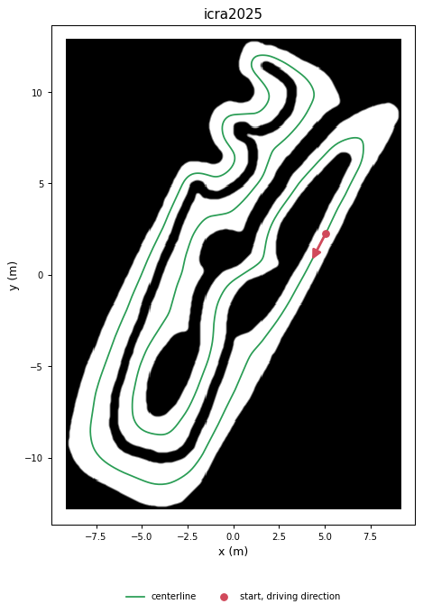
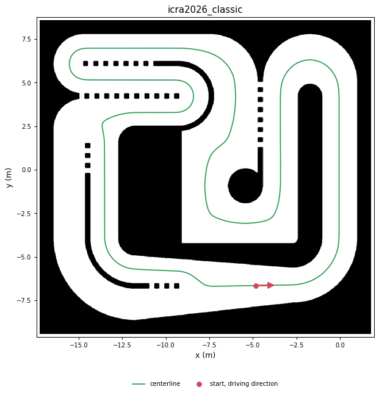
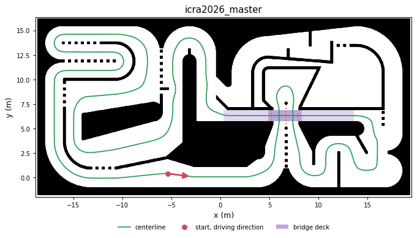
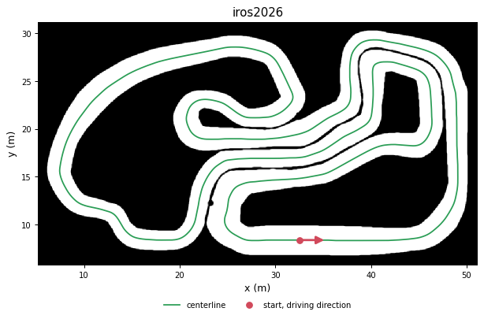
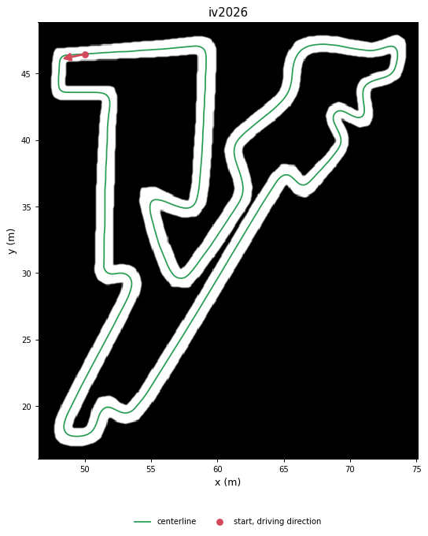
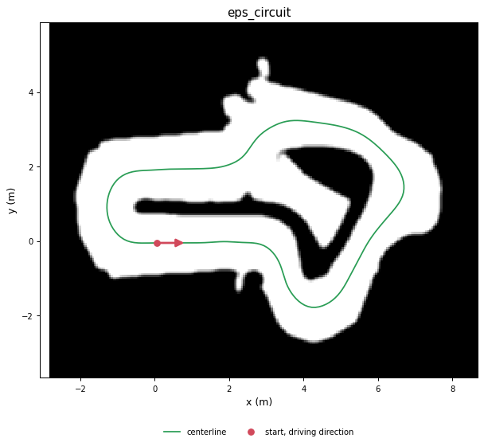
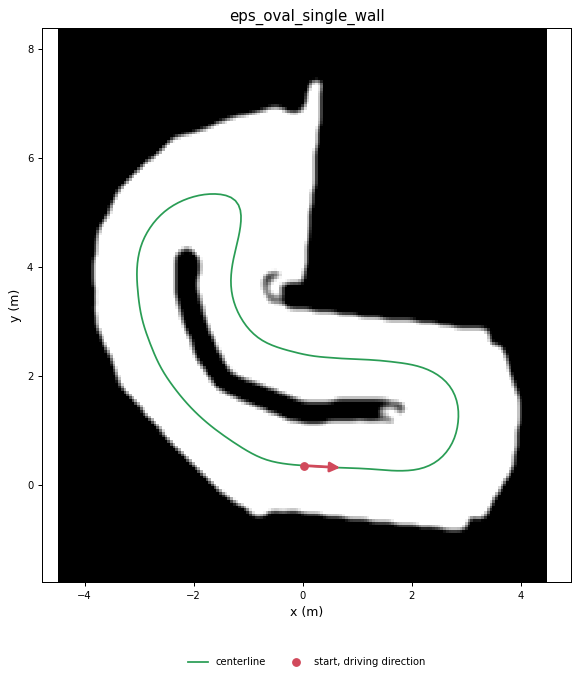
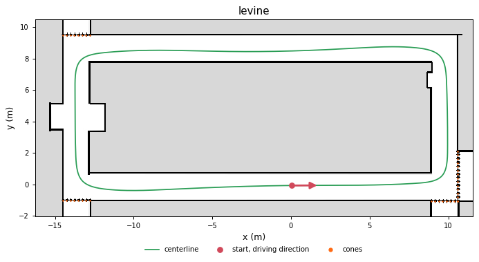
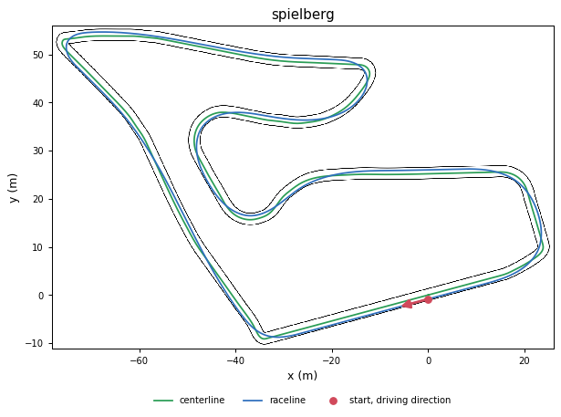

# Map catalog

<!-- Generated by scripts/tracks/catalog.py from src/base_system/rbsf_worlds/tracks/.
     Do not edit by hand: rerun it. -->

Every track in `rbsf_worlds`. Both simulators and the raceline behaviour take any of them as
`track:=<name>`. File formats, provenance and the commands that generated each track:
[`tracks/README.md`](../src/base_system/rbsf_worlds/tracks/README.md). Other tracks mapped by the
car stay in their session (`maps/<stamp>/track/`, `track:=<yaml path>`) and are not listed here.

Lengths are of the closed reference lines. The width is the corridor across the centerline (wall to
wall), its narrowest and widest point. The start is the first point of the reference line, the
start/finish line.

| Track | Source | Lap | Width | Direction | Extras |
|---|---|---|---|---|---|
| [`icra2025`](#icra2025) | ICRA 2025 RoboRacer competition, Atlanta | 101.8 m | 0.89-2.43 m | clockwise | - |
| [`icra2026_classic`](#icra2026_classic) | ICRA 2026 RoboRacer competition, Vienna: Classic Cup | 80.8 m | 1.41-3.48 m | counter-clockwise | - |
| [`icra2026_master`](#icra2026_master) | ICRA 2026 RoboRacer competition, Vienna: Master Cup | 152.5 m | 1.04-5.62 m | counter-clockwise | 1 bridge |
| [`iros2026`](#iros2026) | IROS 2026 RoboRacer competition | 209.4 m | 1.71-3.50 m | counter-clockwise | - |
| [`iv2026`](#iv2026) | IEEE IV 2026 simulation map | 139.9 m | 1.03-1.93 m | counter-clockwise | - |
| [`eps_circuit`](#eps_circuit) | Mapped by our car | 21.1 m | 1.01-1.93 m | counter-clockwise | - |
| [`eps_oval_single_wall`](#eps_oval_single_wall) | Built from one of our mapping sessions | 18.2 m | 1.19-2.62 m | counter-clockwise | - |
| [`levine`](#levine) | f1tenth_gym_ros `maps/levine` | 61.8 m | 1.57-3.42 m | counter-clockwise | 38 cones |
| [`spielberg`](#spielberg) | f1tenth_gym_ros `maps/Spielberg` | 338.1 m | 2.20-2.20 m | clockwise | - |

## icra2025

ICRA 2025 RoboRacer competition, Atlanta. From [Noce99/AuRoRus](https://github.com/Noce99/AuRoRus)
`maps/Atlanta_2025` (UniBo, MIT/Apache-2.0), whose car won that race. The start/finish line and the
driving direction are theirs.

| | |
|---|---|
| Reference lines | centerline 101.8 m |
| Corridor width | 0.89-2.43 m |
| Driving direction | clockwise, from (5.04, 2.24) |
| Footprint | 17.9 x 25.3 m (drivable space), 5 cm/px |
| Extras | - |
| Path-tracking tunings | - |

## icra2026_classic

ICRA 2026 RoboRacer competition, Vienna: Classic Cup. The organisers' map. Dashed walls are open
borders (gaps under 0.4 m); the left side splits into two lanes and the line takes the inner one.

| | |
|---|---|
| Reference lines | centerline 80.8 m |
| Corridor width | 1.41-3.48 m |
| Driving direction | counter-clockwise, from (-4.85, -6.65) |
| Footprint | 17.4 x 16.4 m (drivable space), 1.9 cm/px |
| Extras | - |
| Path-tracking tunings | - |

## icra2026_master

ICRA 2026 RoboRacer competition, Vienna: Master Cup. The organisers' map, with a 0.7 m bridge over
a five-way crossing (3D in MVSim, a flat crossing in f1tenth_gym). The line passes the crossing
twice below the deck and once over it.

| | |
|---|---|
| Reference lines | centerline 152.5 m |
| Corridor width | 1.04-5.62 m |
| Driving direction | counter-clockwise, from (-5.37, 0.39) |
| Footprint | 36.3 x 16.4 m (drivable space), 1.9 cm/px |
| Extras | 1 bridge |
| Path-tracking tunings | - |

## iros2026

IROS 2026 RoboRacer competition. Generated from the organisers' drawing (thin wall lines).

| | |
|---|---|
| Reference lines | centerline 209.4 m |
| Corridor width | 1.71-3.50 m |
| Driving direction | counter-clockwise, from (32.52, 8.38) |
| Footprint | 43.9 x 23.4 m (drivable space), 5 cm/px |
| Extras | - |
| Path-tracking tunings | `iros2026_sim.yaml` |

## iv2026

IEEE IV 2026 simulation map. Generated from the organisers' drawing (1 px wall lines). The drawing
gives no driving direction: counter-clockwise by choice.

| | |
|---|---|
| Reference lines | centerline 139.9 m |
| Corridor width | 1.03-1.93 m |
| Driving direction | counter-clockwise, from (50.04, 46.47) |
| Footprint | 26.6 x 30.8 m (drivable space), 6.25 cm/px |
| Extras | - |
| Path-tracking tunings | - |

## eps_circuit

Mapped by our car. Session `20261021_122444`, Cartographer.

| | |
|---|---|
| Reference lines | centerline 21.1 m |
| Corridor width | 1.01-1.93 m |
| Driving direction | counter-clockwise, from (0.05, -0.04) |
| Footprint | 9.8 x 7.6 m (drivable space), 5 cm/px |
| Extras | - |
| Path-tracking tunings | - |

## eps_oval_single_wall

Built from one of our mapping sessions. Session `20261007_122948`, Cartographer. Bays open off the
loop, so centring controllers drive into them.

| | |
|---|---|
| Reference lines | centerline 18.2 m |
| Corridor width | 1.19-2.62 m |
| Driving direction | counter-clockwise, from (0.03, 0.35) |
| Footprint | 7.7 x 8.2 m (drivable space), 5 cm/px |
| Extras | - |
| Path-tracking tunings | `eps_oval_single_wall_sim.yaml` |

## levine

f1tenth_gym_ros `maps/levine`. Building corridors. Four cone rows close the corridors that lead off
the loop.

| | |
|---|---|
| Reference lines | centerline 61.8 m |
| Corridor width | 1.57-3.42 m |
| Driving direction | counter-clockwise, from (0.03, -0.07) |
| Footprint | 25.9 x 10.5 m (drivable space), 5 cm/px |
| Extras | 38 cones |
| Path-tracking tunings | - |

## spielberg

f1tenth_gym_ros `maps/Spielberg`. The only track with a raceline (with a speed profile). Its
centerline widths are a nominal 1.1 m per side, not measured from the map.

| | |
|---|---|
| Reference lines | centerline 343.3 m, raceline 338.1 m (4.5-8.0 m/s) |
| Corridor width | 2.20-2.20 m |
| Driving direction | clockwise, from (-0.04, -0.85) |
| Footprint | 102.2 x 65.1 m (drivable space), 5.796 cm/px |
| Extras | - |
| Path-tracking tunings | - |
